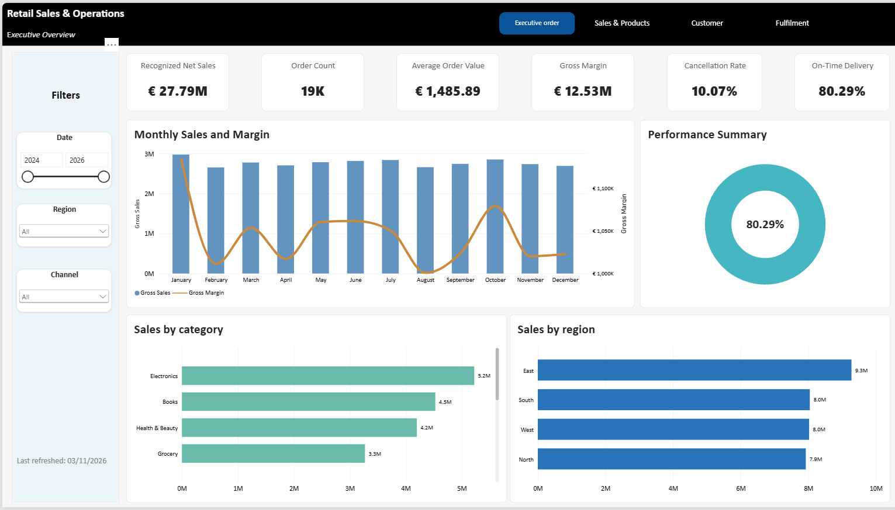
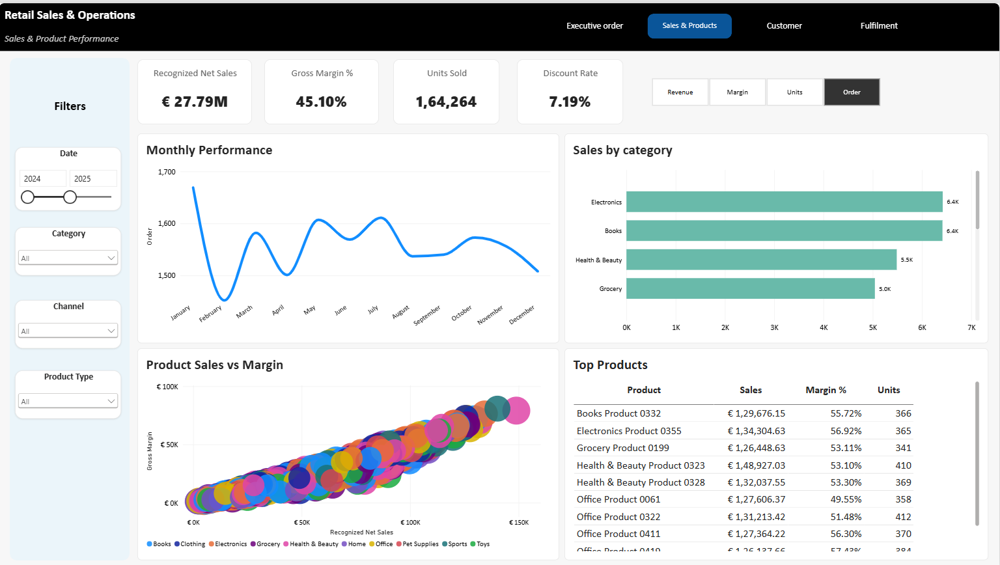
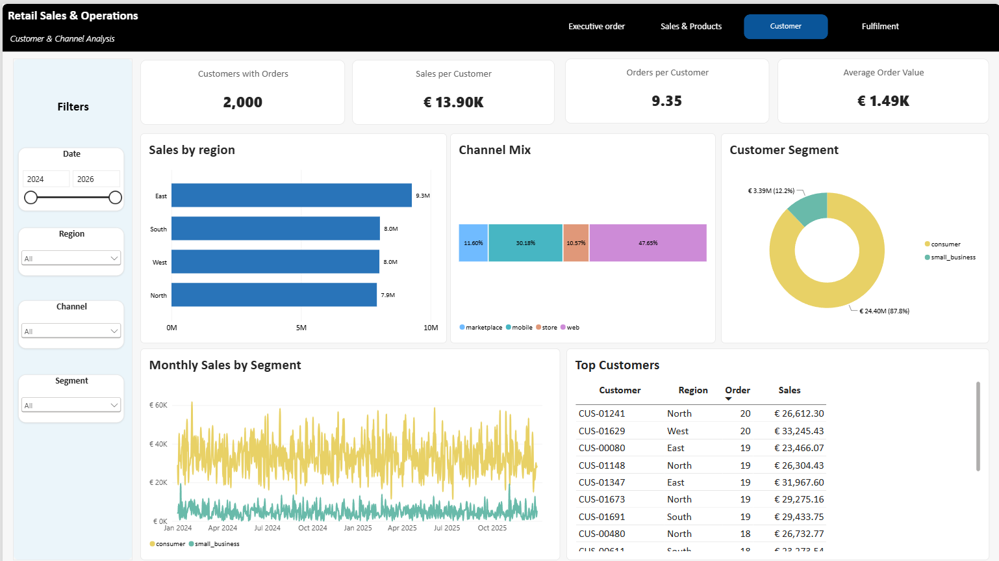
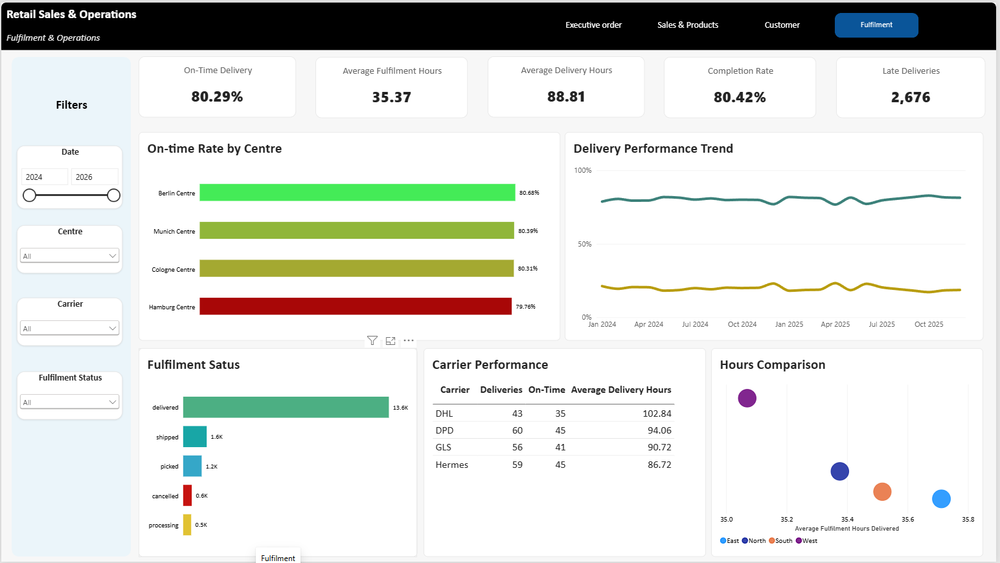
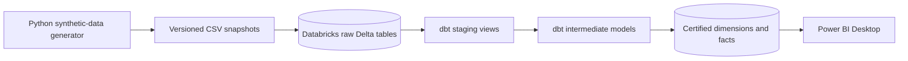

# Retail Sales & Operations Analytics Lakehouse

> **Status:** Stages 1–6 and the final dbt/repository validation are complete. The four-page Power BI report is built; Stage 7 remains open only for the documented visual corrections and final report reconciliation.

A small analytics-engineering portfolio project using synthetic retail order, product, customer, and fulfilment data. The project demonstrates dbt transformations on Databricks Delta tables, one verified incremental `MERGE` workflow, tested dimensional marts, generated documentation, and a four-page Power BI Desktop report over certified models.

This is a non-commercial learning project built on Databricks Free Edition. It is not a production retail, finance, inventory, or fulfilment system and contains no real customer data.

## Dashboard preview

### Executive Overview



### Sales & Products



### Customer



### Fulfilment



## Business questions

The first release will answer:

1. How are gross sales, net sales, order count, units sold, and average order value changing over time?
2. Which product categories and products contribute most to sales?
3. What share of orders is cancelled, delivered on time, or delivered late?
4. How do fulfilment time and on-time performance vary by fulfilment centre?

## Planned deliverables

- Deterministic synthetic retail source data.
- Raw Delta tables in Databricks.
- Documented dbt staging views.
- A verified incremental order-line transformation using Delta `MERGE`.
- Four dimensions and two fact tables with explicit grains.
- Schema, uniqueness, relationship, accepted-value, business-rule, and reconciliation tests.
- Generated dbt documentation.
- A four-page interactive Power BI Desktop report using only certified marts.
- Reproducible setup, validation, security, and limitation notes.

## Architecture



The detailed design contract is in [docs/architecture.md](./docs/architecture.md). The implementation order and completion criteria are in [PROJECT-ROADMAP.md](./PROJECT-ROADMAP.md).

## Technology

- Python 3.11 for deterministic synthetic-data generation.
- dbt Core with the `dbt-databricks` adapter.
- Databricks Free Edition, Unity Catalog, Delta Lake, and a serverless SQL warehouse.
- Power BI Desktop in Import mode.
- Git and GitHub for version control and portfolio documentation.

## Security boundary

- Databricks OAuth will be used for local development where possible.
- `profiles.yml`, `.databrickscfg`, access tokens, workspace hostnames, and SQL warehouse paths must remain outside Git.
- Power BI working `.pbix` files remain ignored because they contain local connection metadata. Four credential-safe report previews are versioned for the portfolio.
- Only synthetic data is permitted.

## Repository structure

```text
data/generated/       Deterministic synthetic CSV snapshots
docs/                 Architecture, stage reports, and safe images
models/staging/       Source-aligned dbt views
models/intermediate/  Reusable transformation logic
models/marts/         Certified dimensions and facts
powerbi/              Sanitized report artifacts
scripts/              Data-generation and validation utilities
tests/                Singular dbt business-rule tests
```

## Current validation

Stage 3 created and loaded the initial deterministic snapshot into five Delta tables in `workspace.retail_raw`:

| Raw table | Rows |
|---|---:|
| `customers` | 2,000 |
| `products` | 500 |
| `orders` | 20,000 |
| `order_lines` | 58,565 |
| `fulfilments` | 16,776 |

All 60 source tests pass, including key uniqueness, required-field, accepted-value, and relationship checks. Both the initial and updated snapshots were generated twice and produced matching SHA-256 hashes. See [the Stage 3 report](./docs/stages/03-synthetic-sources.md) for commands and evidence.

Stage 4 adds five source-aligned staging views and two reusable intermediate views. Its build completed with all 124 selected tasks passing: 7 view models and 117 model and business-rule tests. See [the Stage 4 report](./docs/stages/04-staging-and-intermediate.md) for model grains, commands, and validation evidence.

Stage 5 adds the physical incremental Delta table `workspace.retail_marts.fact_order_line`. The controlled second run inserted 2,364 new keys and updated 836 existing rows through `MERGE`; the final 60,929-row fact reconciles exactly to its source with no duplicate keys. All 210 project tests pass. See [the Stage 5 report](./docs/stages/05-incremental-fact.md) for the reproducible proof.

Stage 6 completes the certified star schema with four dimensions and `fact_order_fulfilment`. The end-to-end build passed all 310 tasks, including 290 data tests and 2 isolated unit tests. Generated dbt documentation exposes model descriptions, columns, tests, and lineage. See [the Stage 6 report](./docs/stages/06-dimensional-marts.md) for the final mart inventory and validation evidence.

The repository and live raw layer contain the updated snapshot: 2,000 customers, 500 products, 20,800 orders, 60,929 order lines, and 17,446 fulfilments. On 3 November 2026, the complete reconstruction and incremental proof were repeated, all 310 dbt tasks passed, and the dbt catalog was regenerated. See [the Stage 8 report](./docs/stages/08-final-validation.md) for the final audit evidence. The four Power BI pages and safe previews are built; the documented field-mapping corrections and final report reconciliation remain before Stage 7 is complete.

## Power BI report

The report uses Import mode and consumes only the six certified tables in `workspace.retail_marts`. Its four navigable pages are:

| Page | Purpose |
|---|---|
| Executive Overview | Headline sales, margin, cancellation, and delivery KPIs with monthly, category, and regional performance |
| Sales & Products | Monthly metric switching, category comparison, product sales-versus-margin analysis, and top products |
| Customer | Regional, channel, and customer-segment mix with monthly segment trends and top customers |
| Fulfilment | Delivery KPIs, centre and carrier performance, fulfilment status, and duration comparison |

The local working `.pbix` is deliberately ignored because it contains connection metadata. The documented measures, reconciliation values, report review checklist, and screenshot instructions are in [the Stage 7 report](./docs/stages/07-power-bi-reporting.md).

## Certified marts

Power BI must consume only these physical Delta tables from `workspace.retail_marts`:

| Model | Grain | Rows |
|---|---|---:|
| `dim_customer` | One row per customer | 2,000 |
| `dim_product` | One row per product | 500 |
| `dim_date` | One row per calendar date | 1,096 |
| `dim_fulfilment_centre` | One row per fulfilment centre | 4 |
| `fact_order_line` | One row per order line | 60,929 |
| `fact_order_fulfilment` | One row per physical-order fulfilment | 17,446 |

Generate and open the dbt catalog locally with:

```powershell
dbt docs generate --profiles-dir .dbt
dbt docs serve --profiles-dir .dbt
```

## Reproduce the project

Prerequisites and OAuth configuration are documented in [Stage 2](./docs/stages/02-dbt-and-databricks-setup.md). From the repository root:

```powershell
python -m venv .venv
.\.venv\Scripts\Activate.ps1
python -m pip install -r requirements.txt

python scripts\generate_synthetic_data.py --snapshot updated
dbt seed --profiles-dir .dbt --full-refresh
dbt build --profiles-dir .dbt
dbt docs generate --profiles-dir .dbt
```

The controlled initial-to-updated Delta `MERGE` demonstration is documented separately in [Stage 5](./docs/stages/05-incremental-fact.md). Do not commit `.dbt/profiles.yml` or the local Power BI file.

## Limitations

- All data is deterministic and synthetic; no real customers or commercial transactions are represented.
- Raw ingestion is simulated with replaceable CSV snapshots and `dbt seed`, not production CDC or streaming.
- Only `fact_order_line` is incremental; the remaining marts are rebuilt at this portfolio scale.
- The design intentionally excludes returns, taxes, multi-currency accounting, inventory forecasting, SCD history, orchestration, CI/CD, and production deployment.
- Power BI uses Import mode and a local Desktop file. Power BI Service publishing, scheduled refresh, row-level security, and enterprise identity are outside scope.
- Databricks Free Edition availability and quotas may affect reproduction time.

## Cleanup

- Stop a local documentation server with `Ctrl+C`.
- Deactivate the Python environment with `deactivate`.
- The ignored `.venv`, `target`, and `logs` directories can be removed locally when no longer required.
- If the Databricks objects are no longer needed, delete only the project schemas `retail_raw`, `retail_staging`, `retail_intermediate`, and `retail_marts` from the selected catalog. This is destructive and should be done only after confirming the catalog and schema names.

## CV wording

**Retail Sales & Operations Analytics Lakehouse — dbt, Databricks & Power BI | 2026**

Built a synthetic retail analytics lakehouse with dbt Core and Databricks SQL, including documented staging and intermediate layers, a Delta `MERGE` incremental fact, star-schema marts, 290 data tests, two unit tests, and a four-page Power BI report covering sales, products, customers, and fulfilment. Reconciled 60,929 order lines and 17,446 fulfilments through automated business-rule and relationship checks; portfolio implementation, not a production system.
