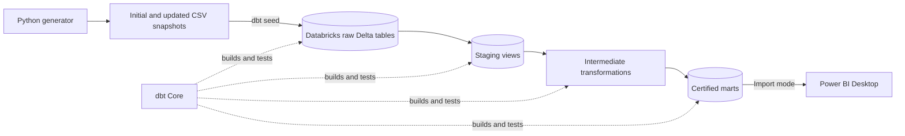

# Retail Sales & Operations Analytics Lakehouse — Architecture

## Purpose

This document is the design contract for the first portfolio release. It fixes the project boundary, source and model grains, incremental strategy, business rules, reporting interface, tests, and security constraints before implementation begins.

The architecture is intentionally small enough for Databricks Free Edition and two focused build sessions. It demonstrates lakehouse and analytics-engineering practices without imitating a production retail platform.

## Scope

The project models synthetic retail activity across January 2024 through December 2025. It covers customers, products, orders, order lines, and fulfilment outcomes.

Approximate first-version scale:

- 2,000 customers
- 500 products across 8–12 categories
- 20,000 orders
- 50,000–80,000 order lines
- One fulfilment record per physical order
- Three to five fulfilment centres

All identifiers and commercial values are synthetic.

## System context



The target catalog will be selected during Databricks setup. With a dbt target schema of `retail`, expected schemas are:

- `<catalog>.retail_raw`
- `<catalog>.retail_staging`
- `<catalog>.retail_intermediate`
- `<catalog>.retail_marts`

## Source contracts

| Source | Grain | Primary key | Purpose |
|---|---|---|---|
| `customers` | One row per customer | `customer_id` | Customer signup, segment, and region attributes |
| `products` | One row per product | `product_id` | Product, category, unit cost, and list price attributes |
| `orders` | One row per order | `order_id` | Customer, order time, channel, payment, and order status |
| `order_lines` | One row per order line | `order_line_id` | Product, quantity, sale price, discount, and update timestamp |
| `fulfilments` | One row per physical order | `fulfilment_id` | Centre, carrier, operational timestamps, promise date, and delivery status |

Required source relationships:

- Every order belongs to one customer.
- Every order line belongs to one order and one product.
- Every fulfilment belongs to one physical order.
- Digital or fully cancelled orders may have no fulfilment record.

## Source update simulation

The generator will support two deterministic states:

1. **Initial snapshot:** original orders, lines, and fulfilment states.
2. **Updated snapshot:** new orders plus controlled changes to existing order, line, and fulfilment records.

The demonstration sequence will be:

```text
generate initial snapshot
dbt seed
dbt build --full-refresh
generate updated snapshot
dbt seed --full-refresh
dbt run --select fact_order_line
dbt test
```

The raw snapshots are replaced deliberately; the certified incremental fact must merge only new or changed business rows.

## Model layers and grains

### Staging views

| Model | Grain |
|---|---|
| `view_customers` | One row per customer |
| `view_products` | One row per product |
| `view_orders` | One row per order |
| `view_order_lines` | One row per order line |
| `view_fulfilments` | One row per fulfilment/order |

Staging models rename fields, cast types, normalize controlled values, and expose source update timestamps. They do not aggregate business measures.

### Intermediate models

| Model | Grain | Purpose |
|---|---|---|
| `view_order_line_enriched` | One row per order line | Join orders, lines, and products; calculate monetary components and an incremental watermark |
| `view_fulfilment_enriched` | One row per fulfilment/order | Calculate operational durations and delivery-performance flags |

### Dimensions

| Model | Grain | Key |
|---|---|---|
| `dim_customer` | One row per customer | `customer_id` |
| `dim_product` | One row per product | `product_id` |
| `dim_date` | One row per calendar date | `date_day` |
| `dim_fulfilment_centre` | One row per fulfilment centre | `fulfilment_centre_id` |

### Facts

| Model | Grain | Unique key | Materialization |
|---|---|---|---|
| `fact_order_line` | One row per order line | `order_line_id` | Incremental Delta table using `merge` |
| `fact_order_fulfilment` | One row per physical order/fulfilment | `fulfilment_id` | Table |

Power BI must query only the certified dimensions and facts.

## Incremental contract

`fact_order_line` is the single intentionally incremental model in the first release.

- Strategy: Delta `merge`
- Unique key: `order_line_id`
- Watermark: the greatest non-null value of the order and order-line `updated_at` timestamps
- Initial run: load all order lines
- Subsequent run: select rows whose watermark is newer than the maximum watermark already stored, plus previously unseen business keys so late-arriving inserts are not missed
- Expected behavior: new order lines are inserted; changed lines or order statuses update existing rows; unchanged rows are not duplicated
- Full refresh: supported for deterministic reconstruction

The incremental proof must record row counts before and after the update, changed keys, inserted keys, and a zero-duplicate result.

## Business rules

### Sales measures

For each order line:

```text
gross_sales_amount = quantity × unit_price
net_sales_amount   = gross_sales_amount − discount_amount
cost_amount        = quantity × unit_cost
gross_margin       = net_sales_amount − cost_amount
```

- Monetary values use two-decimal fixed precision.
- Quantity must be positive.
- Discounts must be non-negative and cannot exceed gross sales.
- Cancelled order lines remain in the fact for operational analysis but contribute zero to recognized net sales.
- Average order value is recognized net sales divided by distinct non-cancelled orders, not an average of line values.

### Fulfilment measures

```text
fulfilment_hours = shipped_at − order_created_at
delivery_hours   = delivered_at − shipped_at
on_time_delivery = delivered_date <= promised_delivery_date
```

- Durations are null until the required events exist.
- Cancelled orders are excluded from delivery-rate denominators.
- Digital orders are excluded from physical fulfilment KPIs.
- A delivered order must have a delivered timestamp.

## Reporting KPIs

The Power BI page will contain:

- Recognized net sales
- Order count
- Units sold
- Average order value
- Cancellation rate
- On-time delivery rate
- Average fulfilment hours
- Monthly sales trend
- Sales by product category
- Fulfilment performance by centre

Every KPI must be traceable to a certified fact column or a documented DAX measure.

## Data-quality strategy

Tests will cover:

- Primary-key uniqueness and non-nullness at every declared grain.
- Source and mart foreign-key relationships.
- Accepted values for customer segment, sales channel, payment status, order status, and fulfilment status.
- Positive quantities and non-negative monetary values.
- Discount bounds and sales-formula reconciliation.
- Timestamp ordering and fulfilment-duration rules.
- One fulfilment per eligible physical order.
- Fact-to-staging row and total reconciliation.
- Incremental inserts, updates, and duplicate prevention.

Tests must fail visibly; invalid data will not be made valid through undocumented defaults.

## Power BI boundary

- Use Power BI Desktop in Import mode.
- Connect through the Databricks SQL warehouse only after the marts pass dbt tests.
- Import only `dim_*` and `fact_*` relations from `retail_marts`.
- Keep report calculations small and document DAX measures.
- Store a credential-safe screenshot in Git.
- Keep local `.pbix` and connection artifacts ignored until reviewed; prefer a sanitized `.pbit` template for distribution.

## Security and cost controls

- Use Databricks Free Edition only; do not start a paid cloud trial for this project.
- Use the included Serverless Starter Warehouse and Free Edition quotas.
- Use OAuth for local dbt authentication where supported.
- Keep `profiles.yml`, `.databrickscfg`, hostnames, HTTP paths, tokens, and cached BI credentials outside Git.
- Use only synthetic data.
- Do not configure scheduled jobs or always-on compute.

## Non-goals

- Production ingestion or change-data capture
- Inventory forecasting or replenishment optimization
- Returns, refunds, taxes, and multi-currency accounting beyond the documented simplified rules
- Slowly changing dimensions or snapshots
- Streaming pipelines
- Orchestration, CI/CD, or production deployment
- Row-level security or enterprise identity integration
- Power BI Service publishing

## Architecture acceptance checks

Implementation may begin only after confirming:

- Every source and model has one explicit grain.
- The incremental unique key and watermark are defined.
- Sales and fulfilment formulas have stated inclusion and exclusion rules.
- Power BI consumes only certified marts.
- Tests cover keys, relationships, formulas, timestamps, reconciliation, and incremental behavior.
- Credentials and workspace connection details remain outside Git.
