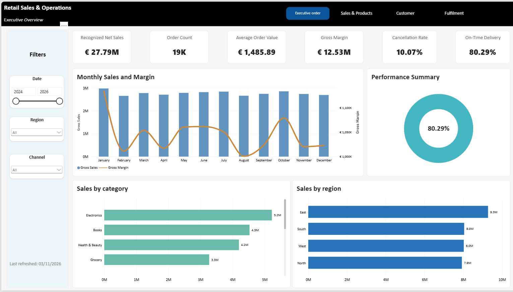
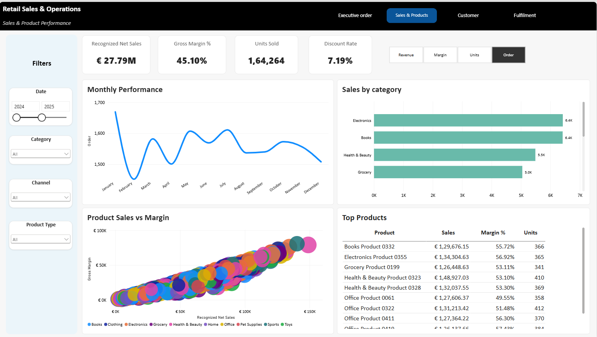
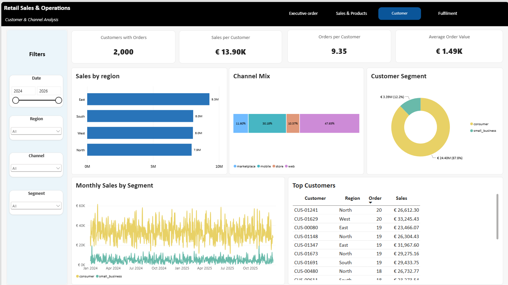
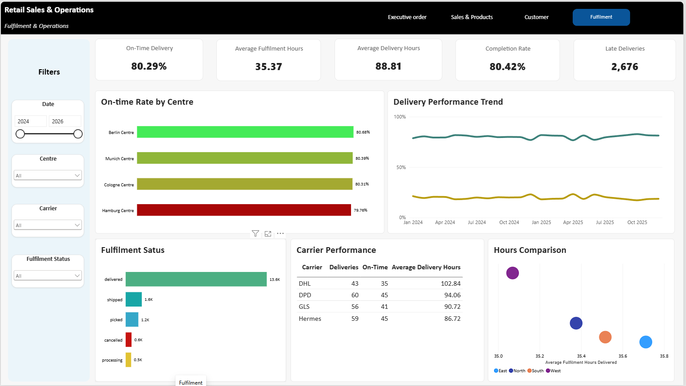

# Stage 7 — Power BI reporting

**Status:** In progress — four report pages and safe previews built; final visual corrections and full reconciliation remain

## Purpose

Present the certified Databricks marts as a readable, interactive portfolio report while keeping business logic traceable and connection details out of Git.

## Reporting boundary

- Power BI Desktop uses Import mode through the Databricks SQL warehouse.
- The semantic model imports only `dim_customer`, `dim_product`, `dim_date`, `dim_fulfilment_centre`, `fact_order_line`, and `fact_order_fulfilment` from `workspace.retail_marts`.
- Fact-to-dimension relationships are many-to-one, with single-direction filter propagation from each dimension to its facts.
- `dim_date[date_day]` is the active order-date relationship for both facts. Other fulfilment event dates are retained for future inactive relationships if required.
- The working `.pbix` remains ignored because it contains local connection metadata. Only credential-safe images and documentation are committed.

## Report pages

| Page | Main content |
|---|---|
| Executive Overview | Sales, orders, AOV, margin, cancellation and on-time KPIs; monthly performance; category and region comparisons |
| Sales & Products | Sales and margin KPIs; switchable monthly metric; category performance; product scatter plot; top-product table |
| Customer | Customer KPIs; region, channel and segment mix; monthly segment trend; top-customer table |
| Fulfilment | Delivery and duration KPIs; centre performance; delivery trend; fulfilment status; carrier table; hours comparison |

The report uses a shared black header, blue active-page navigation, pale filter rail, white visual containers, and the versioned theme at `powerbi/retail-operations-theme.json`.

## Core DAX measure contract

These measures define the intended business calculations. Display names may differ slightly in the local file, but every visual must resolve to the same logic.

```DAX
Gross Sales =
CALCULATE (
    SUM ( fact_order_line[gross_sales_amount_eur] ),
    fact_order_line[order_status] <> "cancelled"
)

Recognized Net Sales =
SUM ( fact_order_line[recognized_net_sales_amount_eur] )

Gross Margin =
CALCULATE (
    SUM ( fact_order_line[gross_margin_amount_eur] ),
    fact_order_line[order_status] <> "cancelled"
)

Gross Margin % =
DIVIDE ( [Gross Margin], [Recognized Net Sales] )

Order Count =
CALCULATE (
    DISTINCTCOUNT ( fact_order_line[order_id] ),
    fact_order_line[order_status] <> "cancelled"
)

All Orders =
DISTINCTCOUNT ( fact_order_line[order_id] )

Cancelled Orders =
CALCULATE (
    DISTINCTCOUNT ( fact_order_line[order_id] ),
    fact_order_line[order_status] = "cancelled"
)

Cancellation Rate =
DIVIDE ( [Cancelled Orders], [All Orders] )

Units Sold =
CALCULATE (
    SUM ( fact_order_line[quantity] ),
    fact_order_line[order_status] <> "cancelled"
)

Average Order Value =
DIVIDE ( [Recognized Net Sales], [Order Count] )

Discount Amount =
CALCULATE (
    SUM ( fact_order_line[discount_amount_eur] ),
    fact_order_line[order_status] <> "cancelled"
)

Discount Rate =
DIVIDE ( [Discount Amount], [Gross Sales] )

Customers with Orders =
CALCULATE (
    DISTINCTCOUNT ( fact_order_line[customer_id] ),
    fact_order_line[order_status] <> "cancelled"
)

Sales per Customer =
DIVIDE ( [Recognized Net Sales], [Customers with Orders] )

Orders per Customer =
DIVIDE ( [Order Count], [Customers with Orders] )

Fulfilment Orders =
DISTINCTCOUNT ( fact_order_fulfilment[fulfilment_id] )

Delivered Orders =
CALCULATE (
    [Fulfilment Orders],
    fact_order_fulfilment[is_delivered] = TRUE ()
)

On-Time Deliveries =
CALCULATE (
    [Fulfilment Orders],
    fact_order_fulfilment[is_delivered] = TRUE (),
    fact_order_fulfilment[is_on_time_delivery] = TRUE ()
)

Late Deliveries =
[Delivered Orders] - [On-Time Deliveries]

On-Time Delivery Rate =
DIVIDE ( [On-Time Deliveries], [Delivered Orders] )

Non-Cancelled Fulfilments =
CALCULATE (
    [Fulfilment Orders],
    fact_order_fulfilment[is_cancelled] = FALSE ()
)

Completion Rate =
DIVIDE ( [Delivered Orders], [Non-Cancelled Fulfilments] )

Average Fulfilment Hours =
AVERAGE ( fact_order_fulfilment[fulfilment_hours] )

Average Delivery Hours =
AVERAGE ( fact_order_fulfilment[delivery_hours] )
```

Currency measures use EUR formatting, rate measures use percentage formatting, counts use whole-number formatting, and duration measures use two decimal places.

## Independent reconciliation benchmarks

The main cards were checked against independent Databricks queries on November 3, 2026.

| Metric | Expected unfiltered value |
|---|---:|
| Recognized net sales | €27,793,501.80 |
| Gross margin | €12,534,020.37 |
| Gross margin rate | 45.10% |
| Non-cancelled order count | 18,705 |
| Average order value | €1,485.89 |
| Cancellation rate | 10.07% |
| Units sold | 164,264 |
| Customers with orders | 2,000 |
| Sales per customer | €13,896.75 |
| Orders per customer | 9.35 |
| Fulfilment orders | 17,446 |
| Delivered orders | 13,575 |
| On-time deliveries | 10,899 |
| Late deliveries | 2,676 |
| On-time delivery rate | 80.29% |
| Average fulfilment hours | 35.37 |
| Average delivery hours | 88.81 |
| Completion rate | 80.42% |

Carrier-level reference values are:

| Carrier | Delivered orders | On-time rate | Average delivery hours |
|---|---:|---:|---:|
| DHL | 3,372 | 79.92% | 89.11 |
| DPD | 3,417 | 80.68% | 88.38 |
| GLS | 3,330 | 80.48% | 88.64 |
| Hermes | 3,456 | 80.06% | 89.11 |

## Final report corrections

Apply these changes before marking Stage 7 complete:

1. Rename the navigation label `Executive order` to `Executive Overview` or `Overview` on every page.
2. Restrict sales-page date slicers to the data period January 2024 through December 2025. Use the same order-date interpretation on all four pages unless an event-date visual is explicitly labelled.
3. On Executive Overview, use `Recognized Net Sales` for category and region visuals so they reconcile to the headline sales card. Use `Gross Margin %`, rather than a currency amount, for the secondary line if the visual is intended to compare margin rate.
4. Rebuild Performance Summary as a two-part `On time` versus `Late` donut with a legend, or replace it with a different breakdown. The current solid ring visually implies 100% even though its label is 80.29%.
5. Remove the Executive Overview category scrollbar by applying a Top N filter or increasing the visual height.
6. On Sales & Products, make the monthly and category titles respond to the selected field parameter—for example, `Orders by Category` when Orders is selected. Rename the selector item `Order` to `Orders`.
7. Change the product scatter Y-axis to `Gross Margin %`; absolute margin is mechanically correlated with sales. Limit the visual to the top 50 products by `Recognized Net Sales` and retain product, category, units, and margin in the tooltips.
8. On Customer, ensure Sales by Region uses `Recognized Net Sales`. Change Monthly Sales by Segment to `dim_date[year_month]` or `month_start_date`; the current daily axis is too dense for a monthly visual.
9. On Fulfilment, rebuild Carrier Performance with `[Delivered Orders]`, `[On-Time Delivery Rate]`, and `[Average Delivery Hours]`. The current counts such as 43 and 60 do not reconcile to the certified fact. Format the on-time column as a percentage.
10. Add a visible legend to Delivery Performance Trend so the on-time and late lines are unambiguous. For On-time Rate by Centre, use an explicit 80% target line and target-based colours instead of a relative red-to-green scale that exaggerates small differences.
11. Rename Hours Comparison to `Fulfilment vs Delivery Hours by Centre`, add the Y-axis title, and include centre name and both durations in the tooltip. Optional average lines will make outliers easier to interpret.
12. Check visual interactions so each relevant slicer filters every visual on its page, while navigation buttons do not retain an unintended selection state.

## Final evidence to capture

After the corrections:

1. Refresh the model and confirm the benchmark cards above.
2. Verify each page with slicers cleared.
3. Confirm that no hostname, HTTP path, token, account name, or workspace identifier appears in the report canvas or screenshots.
4. Export one full-page PNG per report page into `docs/images/` using the filenames listed in [the image guide](../images/README.md).
5. Add the Executive Overview image to the root README and link the remaining screenshots from this stage report.

Stage 7 is complete only after all correction items are resolved, the benchmarks reconcile, and safe report images are versioned.

## Current report preview

The following credential-safe images document the current four-page report. They should be re-exported with the same filenames after the final corrections above.

### Executive Overview



### Sales & Products



### Customer



### Fulfilment


